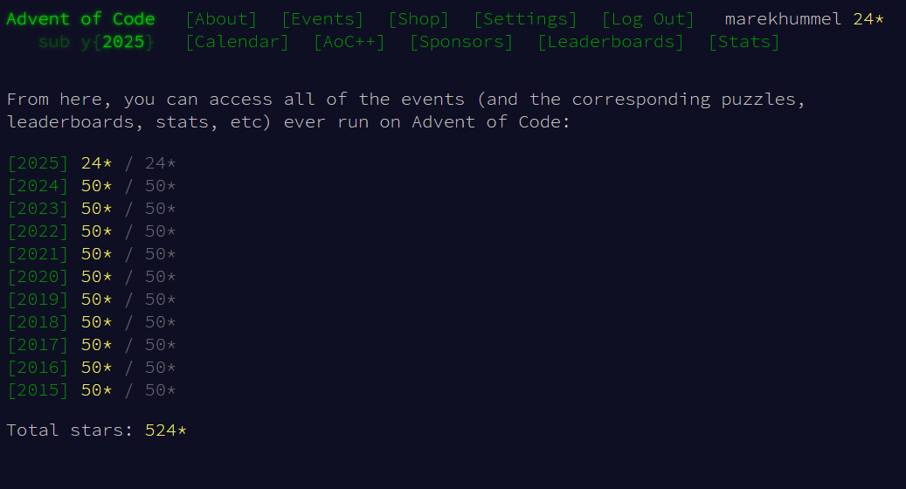

# Advent of Code

My [Advent of Code](https://adventofcode.com/) solutions in Rust, Python, Go,
Zig, Elixir, C++, Lua and Dart, with shared libraries and tasks for running and verifying answers.

| Year | Rust | Zig | Elixir | C++ | Python | Golang | Lua | Dart |
| --- | :---: | :---: | :---: | :---: | :---: | :---: | :---: | :---: |
| [2015](src/2015/README.md) | ✓ | — | — | — | — | 07 | — | — |
| [2016](src/2016/README.md) | ✓ | — | — | — | — | 10 | — | — |
| [2017](src/2017/README.md) | ✓ | — | — | — | — | — | — | — |
| [2018](src/2018/README.md) | ✓ | — | — | — | — | — | — | — |
| [2019](src/2019/README.md) | ✓ | — | — | — | — | — | — | — |
| [2020](src/2020/README.md) | ✓ | — | — | — | — | — | — | — |
| [2021](src/2021/README.md) | ✓ | — | — | — | — | — | — | — |
| [2022](src/2022/README.md) | ✓ | — | — | — | — | — | — | — |
| [2023](src/2023/README.md) | ✓ | — | — | — | 01-06, 12, 24 | — | — | — |
| [2024](src/2024/README.md) | 06 | ✓ | — | — | — | 24 | — | — |
| [2025](src/2025/README.md) | — | — | ✓ | — |10 | — | — | — |
| [2026](src/2026/README.md) | — | — | — | — | — | — | — | — |

See [progress/](progress/) for yearly screenshots and the linked year READMEs
for individual summaries.

## Repo Overview

| Folder / files | Language | Purpose |
| --- | --- | --- |
| `src/YEAR/LANGUAGE/` | All | Yearly solutions and entry points |
| `src/lib/` | All | Shared libraries and runners |
| `inputs/YEAR/` | All | Puzzle inputs (not commited), samples and `sample_solutions.json` |
| `progress/` | All | Overall progress image and yearly screenshots |
| `Taskfile.yml`, `scripts/` | All | Commands, helper scripts and day templates |
| `.devcontainer/` | All | Tool installation and VS Code settings |
| `Cargo.toml`, `Cargo.lock`, `.cargo/`, `.rustfmt.toml` | Rust | Packages, dependencies, compiler and formatter configuration |
| `requirements.txt`, `pyproject.toml` | Python | Dependencies, linting, formatting and type-check configuration |
| `go.mod` | Go | Module and language version |
| `.clang-format` | C++ | Formatting; Taskfile builds C++23 into `build/cpp/` |
| `build.zig`, `build.zig.zon` | Zig | Build steps and dependencies |
| `mix.exs`, `mix.lock`, `.elixir_ls/`  | Elixir | Mix project, build steps and dependencies, local cache |
| `.stylua.toml`, `.luarc.json` | Lua | Formatting and language-server settings; shared runner in `src/lib/lua/` |
| `analysis_options.yaml` | Dart | Static analysis settings; Taskfile builds into `build/dart/` |
| `.gitignore`| All | Git exclusions (build, inputs and session token) |

## Usage

[Taskfile.yml](Taskfile.yml) and the helper [scripts](scripts/) handle running,
verification and inputs. Use `task --list` to list available tasks.

| Task | Purpose |
| --- | --- |
| `task list` | List all year/language directories |
| `task run:<language>` | Run solutions with timing |
| `task verify:<language>` | Verify answers for one language |
| `task verify` | Verify answers across all languages |
| `task input` | Download puzzle inputs |
| `task cookie` | Import a Firefox session; run on the host |

Arguments select the year, day, part and input mode. `OPTIMIZE` selects a
release (`fast`) or debug build. Verification accepts year and day filters;
`--verbose` includes passing and skipped results.

## Development

### Installation

The devcontainer installs common shell, Git, download and C build tools, Task,
Rust/Cargo, Go, Zig, Elixir/Erlang/Mix, Python 3.15, Lua 5.4 with StyLua, Luacheck and LuaLS,
the stable Dart SDK,
and Clang/LLVM 23 with libc++
for C++23, together with formatters, linters, type checkers and editor extensions. The host needs Docker, VS Code
and its Dev Containers extension.

| Task | Purpose |
| --- | --- |
| `task build:<language>` | Build a year; for Python, install project dependencies |
| `task check:<language>` | Format, lint and check source code |
| `task newday:<language>` | Create a day from its template and register it |

Languages are named `rust`, `python`, `golang`, `zig`, `elixir`, `cpp`, `lua` and `dart` in task names.

Lua tools are installed independently of VS Code. The editor and `task check:lua`
use the same LuaLS executable and `.luarc.json` settings. LuaLS checks the whole
Lua workspace; `YEAR` filters formatting and linting. CLI logs and generated
definitions are stored in `build/lua/luals/`.

Dart's SDK includes its formatter, analyser and language server; no extra packages
are needed. `task check:dart` formats and analyses the code using the same SDK as
VS Code. Release builds are native executables; debug builds run on the Dart VM.

### Library Contract

Each `src/lib/LANGUAGE/` must provide typed inputs and results, a representation
of a day's two parts, and a runner with a day-to-solution map. Part functions
receive input lines and a sample flag; Zig additionally receives an allocator.
Results distinguish integer answers, text answers and informational statuses.
Floating-point answers must be explicitly formatted as strings by the part.

| Language | Day registration and part contract | Result representation |
| --- | --- | --- |
| Rust | Struct implementing `Solution`; map of boxed trait objects; default methods | `Signed(i128)`, `Unsigned(u128)`, big integer, text and statuses |
| Python | Subclass of `Solution`; map of classes; default static methods | Integer/text/status enum union |
| Zig | Day module adapted to a struct with two typed function pointers; missing functions get defaults | `Signed(i128)`, `Unsigned(u128)`, text and status union |
| Elixir | Day module implementing `AocLib.Solution`; map of modules; optional callbacks | Integer/string/status atom union |
| Lua | Day table with annotated functions; map of tables | Integer/string/tagged status union |
| Dart | Common `Solution` class with typed function fields; map of instances | Sealed integer/text/status variants |
| C++ | Common `Solution` struct with typed function pointers; map of instances | `intmax_t`/`uintmax_t`, text and status variant |
| Go | Common `Solution` struct with typed function fields; map of instances | Generic `Signed`/`Unsigned` constructors widen to 64 bits; formatted answer or status |

Unfinished parts return `NotImplemented`; an unregistered day returns `Unsolved`.
`NoSample` (problem statement has no sample) and `NoPartTwo` (typical for day 25) are also successful informational outcomes. Missing
part functions are handled as `NotImplemented`. Templates use their final import
paths and are excluded from checks.

The runner accepts `DAY PART MODE` (`real` or `sample`), reads
`inputs/YEAR/{input,sample}DD.txt` with a `_PART` fallback, and prints only the
answer or formatted status to stdout. Informational outcomes exit with 0;
missing input and execution errors fail, with diagnostics on stderr; invalid
arguments exit with 2. Task and scripts handle builds, batching, timing and
verification; additional library utilities are optional.
