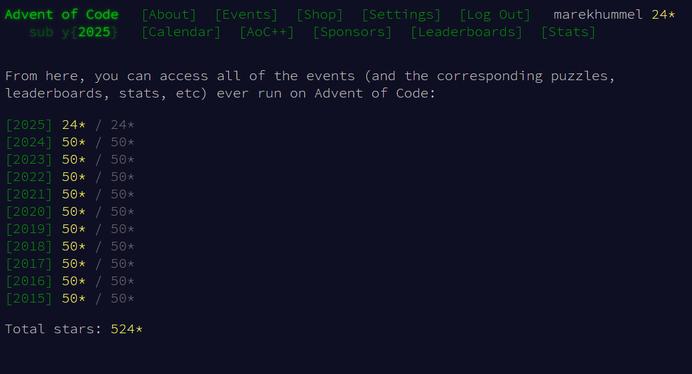

# Advent of Code

My [Advent of Code](https://adventofcode.com/) solutions in Rust, Python, Go,
Zig, Elixir and C++, with shared libraries and tasks for running and verifying answers.

| Year | Rust | Zig | Elixir | C++ | Python | Golang |
| --- | :---: | :---: | :---: | :---: | :---: | :---: |
| [2015](src/2015/README.md) | ✓ | — | — | — | — | 07 |
| [2016](src/2016/README.md) | ✓ | — | — | — | — | 10 |
| [2017](src/2017/README.md) | ✓ | — | — | — | — | — |
| [2018](src/2018/README.md) | ✓ | — | — | — | — | — |
| [2019](src/2019/README.md) | ✓ | — | — | — | — | — |
| [2020](src/2020/README.md) | ✓ | — | — | — | — | — |
| [2021](src/2021/README.md) | ✓ | — | — | — | — | — |
| [2022](src/2022/README.md) | ✓ | — | — | — | — | — |
| [2023](src/2023/README.md) | ✓ | — | — | — | 01-06, 12, 24 | — |
| [2024](src/2024/README.md) | 06 | ✓ | — | — | — | 24 |
| [2025](src/2025/README.md) | — | — | ✓ | — |10 | — |
| [2026](src/2026/README.md) | — | — | — | — | — | — |

See [progress/](progress/) for yearly screenshots and the linked year READMEs
for individual summaries.

## Repo Overview

| Folder / files | Language | Purpose |
| --- | --- | --- |
| `src/YEAR/LANGUAGE/` | All | Yearly solutions and entry points |
| `src/lib/` | All | Shared libraries and runners |
| `inputs/YEAR/` | All | Puzzle inputs (not commited), samples and `sample_solutions.json` |
| `progress/` | All | Overall progress image and yearly screenshots |
| `Taskfile.yml`, `scripts/` | All | Commands, helper scripts and day templates |
| `.devcontainer/` | All | Tool installation and VS Code settings |
| `Cargo.toml`, `Cargo.lock`, `.cargo/`, `.rustfmt.toml` | Rust | Packages, dependencies, compiler and formatter configuration |
| `requirements.txt`, `pyproject.toml` | Python | Dependencies, linting, formatting and type-check configuration |
| `go.mod` | Go | Module and language version |
| `.clang-format` | C++ | Formatting; Taskfile builds C++23 into `build/cpp/` |
| `build.zig`, `build.zig.zon` | Zig | Build steps and dependencies |
| `mix.exs`, `mix.lock`, `.elixir_ls/`  | Elixir | Mix project, build steps and dependencies, local cache |
| `.gitignore`| All | Git exclusions (build, inputs and session token) |

## Usage

[Taskfile.yml](Taskfile.yml) and the helper [scripts](scripts/) handle running,
verification and inputs. Use `task --list` to list available tasks.

| Task | Purpose |
| --- | --- |
| `task list` | List all year/language directories |
| `task run:<language>` | Run solutions with timing |
| `task verify:<language>` | Verify answers for one language |
| `task verify` | Verify answers across all languages |
| `task input` | Download puzzle inputs |
| `task cookie` | Import a Firefox session; run on the host |

Arguments select the year, day, part and input mode. `OPTIMIZE` selects a
release (`fast`) or debug build. Verification accepts year and day filters;
`--verbose` includes passing and skipped results.

## Development

### Installation

The devcontainer installs common shell, Git, download and C build tools, Task,
Rust/Cargo, Go, Zig, Elixir/Erlang/Mix, Python 3.15 and Clang/LLVM 23 with libc++
for C++23, together with formatters, linters, type checkers and editor extensions. The host needs Docker, VS Code
and its Dev Containers extension.

| Task | Purpose |
| --- | --- |
| `task build:<language>` | Build a year; for Python, install project dependencies |
| `task check:<language>` | Format, lint and check source code |
| `task newday:<language>` | Create a day from its template and register it |

Languages are named `rust`, `python`, `golang`, `zig`, `elixir` and `cpp` in task names.
